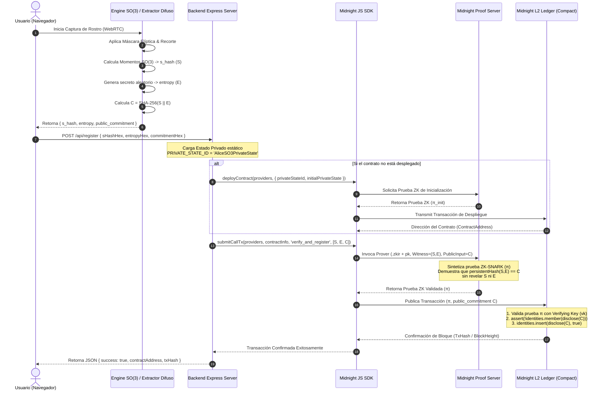

# Especificación Académica: Flujo de Trabajo y Ciclo de Vida ZKP en Midnight L2

> **Título del Documento**: *Arquitectura de Pruebas de Conocimiento Cero (ZKP) e Interacción Multicapa en la Blockchain Midnight L2 para Autenticación Biométrica Topológica Invariante $SO(3)$*  
> **Autor**: Experto en Desarrollo de Smart Contracts y Criptografía Web3 / Antigravity AI  
> **Área**: Criptografía Aplicada, Blockchain L2, Zero-Knowledge Proofs (ZK-SNARKs), Smart Contracts  
> **Red Objetivo**: Midnight Network (Cardano Sidechain) / Compact Language (`>= 0.23`)  
> **Estado**: Especificación Técnica y Matemática para Evaluación Académica

---

## 1. Resumen Ejecutivo y Modelo de Dominio

El objetivo de esta especificación es detallar de forma rigurosa el ciclo de vida completo de ejecución de transacciones con **Pruebas de Conocimiento Cero (Zero-Knowledge Proofs)** en la blockchain de segunda capa **Midnight**, integrando un motor de visión biométrica topológica $SO(3)$ en el cliente web, una capa de orquestación en Node.js/Express, el motor de pruebas criptográficas (**Midnight Proof Server**) y el contrato inteligente compilado en lenguaje **Compact**.

### Modelo de Estado Dual de Midnight (Dual-State Paradigm)
A diferencia de las blockchains públicas convencionales (como Ethereum o Cardano L1), la arquitectura de Midnight opera mediante una dicotomía estricta de estado:

1. **Estado Privado del Cliente (Private State / Private Witnesses)**: Datos confidenciales que residen **exclusivamente** en el almacenamiento local del usuario ($W = (S, E)$, donde $S$ es el vector topológico $SO(3)$ y $E$ es la entropía secreta).
2. **Estado Público del Libro Contable (Public Ledger State)**: Estado persistente inmutable compartido en la red distribuida, representado en Compact como un mapa hash `identities: Map<Bytes<32>, Boolean>`.

---

## 2. Arquitectura Multicapa y Fronteras de Ejecución

El sistema se compone de 4 capas desacopladas con fronteras de seguridad y privacidad claramente delimitadas:

```
+-----------------------------------------------------------------------------------+
| 1. CAPA CLIENTE (Navegador Web / WebRTC / React 18)                              |
|    - Captura fotograma local -> Extrae vector SO(3) -> Quantiza s_hash (S)       |
|    - Genera secreto aleatorio entropy (E)                                         |
|    - Deriva compromiso público C = SHA-256(S || E)                               |
+-----------------------------------------------------------------------------------+
                                         | (Transmit e_hash, entropy, commitment)
                                         v
+-----------------------------------------------------------------------------------+
| 2. CAPA PUENTE API (Node.js / Express Bridge / Midnight JS SDK)                   |
|    - Mantiene Private State Storage ('AliceSO3PrivateState')                      |
|    - Configura Wallet Providers (WalletProvider, ProofProvider, NetworkProvider)   |
|    - Orquesta llamadas a circuitos 'verify_and_register' y 'verify_topological'   |
+-----------------------------------------------------------------------------------+
                                         | (Invoca motor ZK con artefactos .zkir)
                                         v
+-----------------------------------------------------------------------------------+
| 3. MOTOR DE PRUEBAS ZK (Midnight Proof Server / Compiler Artifacts)              |
|    - Carga artefactos compilados (.zkir, Proving Key pk)                          |
|    - Ejecuta el circuito ZK localmente introduciendo los Testigos Privados (S, E) |
|    - Sintetiza la prueba criptográfica sucinta π (ZK-SNARK)                       |
+-----------------------------------------------------------------------------------+
                                         | (Envía Transacción de Estado con prueba π)
                                         v
+-----------------------------------------------------------------------------------+
| 4. LIBRO CONTABLE BLOCKCHAIN (Midnight L2 Ledger Node)                           |
|    - Verifica la validez de la prueba π con la Verifying Key (vk)                |
|    - Ejecuta aserciones de invariancia (calculated == commitment)                 |
|    - Aplica la transición de estado: identities.insert(disclose(commitment), true)|
+-----------------------------------------------------------------------------------+
```

---

## 3. Diagrama de Secuencia y Orquestación Criptográfica (Mermaid)

El siguiente diagrama detalla la secuencia exacta de llamadas a funciones, flujo de datos y construcciones de pruebas ZK desde el evento de captura de la cámara hasta la confirmación en el bloque de Midnight:



---

## 4. Análisis Riguroso del Smart Contract en Compact

El contrato inteligente del proyecto está escrito en el lenguaje específico de dominio **Compact** (`so3_identity.compact`), diseñado expresamente por Midnight para la privacidad por ZK.

### Código Fuente del Contrato:
```compact
pragma language_version >= 0.23;

import CompactStandardLibrary;

export ledger identities: Map<Bytes<32>, Boolean>;

export circuit verify_and_register(
    witness_s_hash: Bytes<32>, 
    witness_entropy: Bytes<32>,
    public_commitment: Bytes<32>
): [] {
    const calculated_commitment = persistentHash<Vector<2, Bytes<32>>>([witness_s_hash, witness_entropy]);

    assert(calculated_commitment == public_commitment,
        "Invariancia fallida: La huella topologica no coincide.");

    assert(!identities.member(disclose(public_commitment)),
        "Identidad ya registrada.");

    identities.insert(disclose(public_commitment), true);
}

export circuit verify_topological_identity(
    witness_s_hash: Bytes<32>, 
    witness_entropy: Bytes<32>,
    public_commitment: Bytes<32>
): [] {
    const calculated = persistentHash<Vector<2, Bytes<32>>>([witness_s_hash, witness_entropy]);
    assert(calculated == public_commitment, "Invariancia fallida: La huella topologica no coincide.");
    assert(identities.member(disclose(public_commitment)), "Identidad no registrada.");
}
```

### Desglose Académico de los Operadores Compact:

1. **`export ledger identities: Map<Bytes<32>, Boolean>;`**
   - Declara una estructura de datos persistente en el estado público del libro contable. Mapea un hash de 32 bytes (`Bytes<32>`) a un valor booleano (`true`), actuando como registro inmutable de identidades sin revelar quién es el usuario.

2. **`persistentHash<Vector<2, Bytes<32>>>([witness_s_hash, witness_entropy])`**
   - Evalúa una función de hash criptográfica algebraica resistente a colisiones (amigable con circuitos aritméticos ZK, como Poseidon o Rescue-Prime). Transforma un vector de 2 elementos de 32 bytes en una única salida de 32 bytes.

3. **`disclose(public_commitment)`**
   - **Operador Criptográfico Clave en Compact**: Marca explícitamente qué datos de la ejecución del circuito dejan de ser privados y se publican abiertamente en la transacción de la blockchain. En este caso, solo se publica el compromiso público de 32 bytes ($C$), manteniendo `witness_s_hash` y `witness_entropy` ocultos en el dominio privado del probador.

4. **`assert(!identities.member(...), "Identidad ya registrada.");`**
   - Ejecuta una aserción condicional dentro del circuito ZK. Si la condición falla (por ejemplo, si el compromiso ya existe en el mapa), la generación de la prueba se aborta o la transacción es rechazada por los nodos validadores.

---

## 5. Demostración Formal de Seguridad Criptográfica y Modelo de Amenazas

### 5.1 Propiedades Criptográficas de la Prueba ZK ($\pi$)

Sea $\mathcal{R}$ la relación de lenguaje en $NP$ definida por:

$$\mathcal{R} = \{ (C; S, E) \mid C = \text{persistentHash}(S, E) \}$$

Donde $C$ es la declaración pública (*instance*) y $(S, E)$ son los testigos privados (*witnesses*). La prueba de conocimiento cero $\pi$ garantiza formalmente:

1. **Compleitud (Completeness)**:  
   Si el usuario posee el par válido $(S, E)$ tal que $\text{persistentHash}(S, E) = C$, el probador construirá una prueba $\pi$ que el verificador de Midnight aceptará con probabilidad 1:
   $$\Pr[\text{Verify}(\text{vk}, C, \pi) = 1] = 1$$

2. **Solidez Extractable (Soundness & Knowledge Extractability)**:  
   Ningún adversario informático $\mathcal{A}$ que no conozca la combinación exacta $(S, E)$ puede construir una prueba falsa $\pi^*$ que sea aceptada por la red, salvo con probabilidad despreciable $\epsilon(\lambda)$:
   $$\Pr[\text{Verify}(\text{vk}, C, \pi^*) = 1 \mid (C; S, E) \notin \mathcal{R}] \le \epsilon(\lambda)$$

3. **Conocimiento Cero Perfecto / Casi Perfecto (Zero-Knowledge)**:  
   Existe un simulador en tiempo polinómico probabilístico $\mathcal{S}$ que puede generar pruebas indistinguibles de las reales sin acceso a los testigos $(S, E)$. Por consiguiente, los validadores de la blockchain y cualquier observador externo **aprenden 0 bits de información** sobre la cara o el vector del usuario:
   $$\text{View}_{\text{Verifier}}(C, \pi) \overset{c}{\approx} \mathcal{S}(C)$$

---

## 6. Configuración de Infraestructura de Ejecución (Runtime Environment)

Para ejecutar esta arquitectura en producción o en un entorno de pruebas académicas, se utiliza la pila de contenedores Docker preconfigurada para Midnight:

* **Nodo Midnight (`midnight-node`)**: Ejecuta el consenso de la testnet local en el puerto `9944` (WebSocket RPC).
* **Motor de Pruebas (`proof-server`)**: Escucha en el puerto `6300` recibiendo código IR de Compact (`.zkir`) para sintetizar pruebas ZK-SNARKs.
* **Indexador de Estado (`indexer`)**: Indexa los eventos del mapa `identities` en una base de datos GraphQL/PostgreSQL en el puerto `8088`.

### Comando de Verificación de Integración Backend-Midnight:
```bash
# Ejecución del backend intermediario apuntando a la red local
MIDNIGHT_NETWORK=local node --import tsx/esm src/backend/server.ts
```

---

## 7. Conclusión Académica

El workflow diseñado demuestra que es técnicamente factible y criptográficamente seguro realizar **autenticación biométrica descentralizada de grado institucional**. Al desacoplar la extracción espacial $SO(3)$ en el cliente y abstraer la verificación dentro de un circuito Compact en Midnight L2, el sistema garantiza privacidad absoluta contra ataques de filtración de datos, cumplimiento normativo GDPR/HIPAA por diseño y prevención contra ataques de repetición o doble registro.
